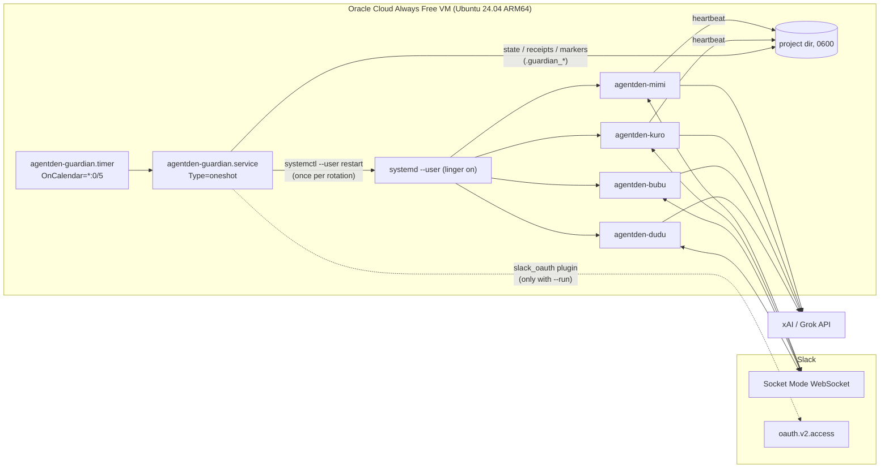
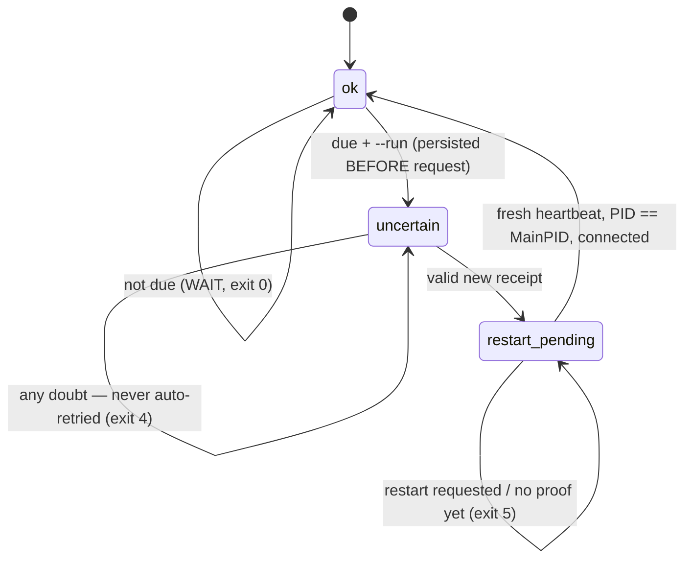

# Architecture

One small ARM64 VM, four long-running Python processes, one timer. No Docker,
no orchestrator, no database.

## Pieces

| Piece | Where | Notes |
| --- | --- | --- |
| Agents | `*_bot.py` (private) | Slack Bolt + Socket Mode, so no public HTTP endpoint is needed. |
| Units | `agentden generate` | `Restart=on-failure`, `RestartSec=10`, `UMask=0077`. |
| Persistence | `loginctl enable-linger` | User services run without an SSH session. |
| Guardian | `agentden.guardian` | Generic state machine; no provider code. |
| Slack plugin | `agentden.slack_oauth` | Only module that talks to an OAuth endpoint. |

## Guardian state machine

Any inconsistency (incident marker, receipt/state mismatch, bad dates,
restart failure) returns **BLOCKED (exit 3)** without changing state.

## Exit codes

| Code | Meaning | Unit result |
| --- | --- | --- |
| 0 | OK / WAIT / step completed | success |
| 1 | unexpected error | failed |
| 2 | bad config / usage | failed |
| 3 | BLOCKED, human needed | failed |
| 4 | UNCERTAIN, do not retry | failed |
| 5 | PENDING restart/proof | success (`SuccessExitStatus=5 6`) |
| 6 | DUE, dry run | success |

With several agents, the worst code wins.
